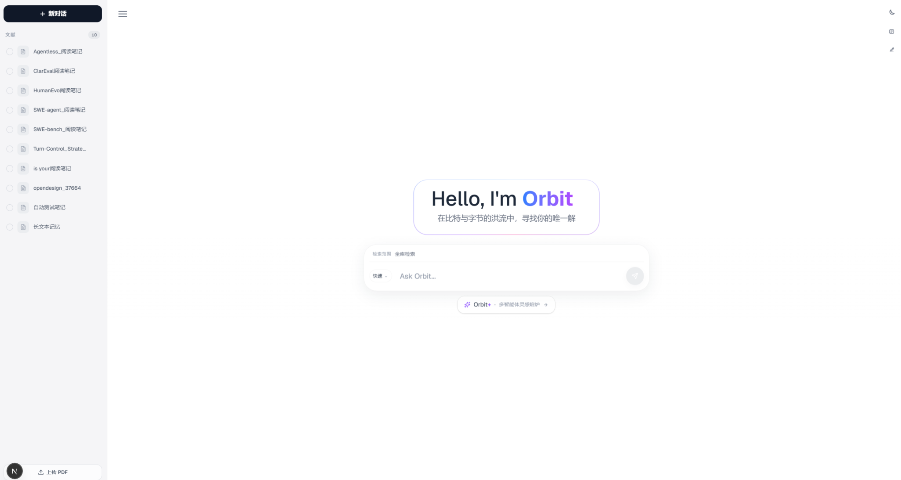
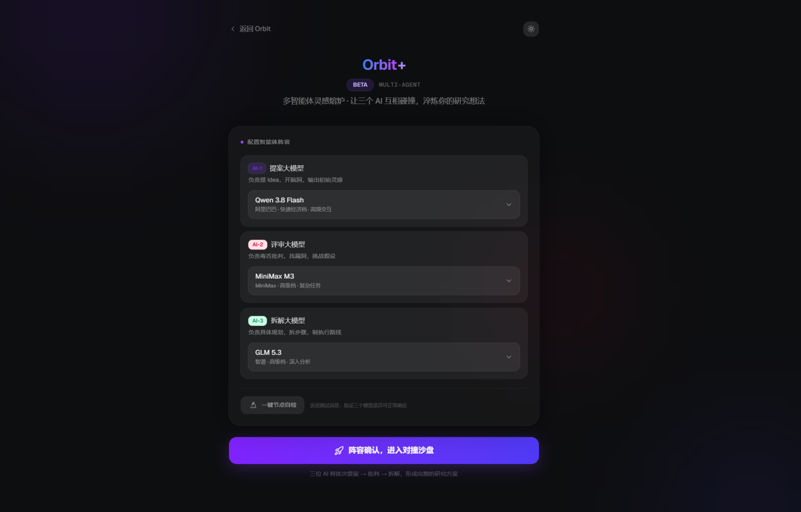
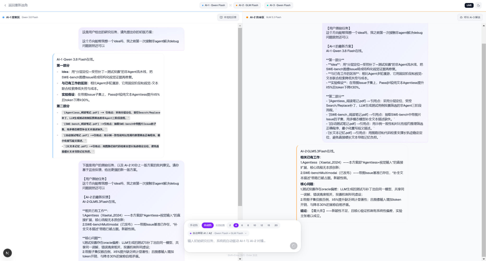
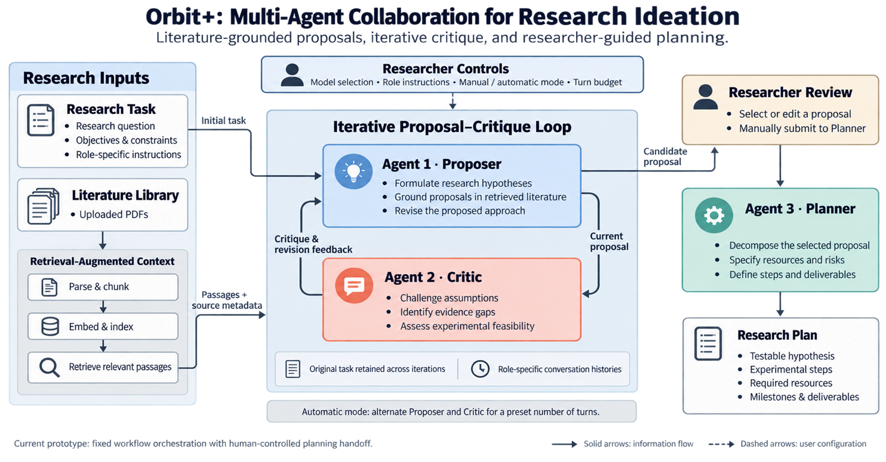

<div align="center">

# Orbit · Orbit+

**从文献证据到研究假设，从批判性讨论到实验计划。**

Literature-grounded Research Assistance & Multi-Agent Ideation

`Retrieval-Augmented Generation` · `Multi-Agent Collaboration` · `Human-in-the-Loop`

[界面预览](#界面预览) · [系统设计](#系统设计) · [快速开始](#快速开始) · [评估与演进](#评估与演进)

</div>

Orbit 是一个面向科研阅读与研究构思的交互式工作台。它将本地 PDF 知识库、带来源信息的检索问答，以及角色分工明确的多模型讨论连接起来，支持从理解文献、提出假设，到审视方案与拆解实验的工作过程。

项目包含两个相互衔接的入口：**Orbit** 聚焦文献阅读与证据检索；**Orbit+** 聚焦研究构思，通过 Proposer、Critic 与 Planner 三种角色，让方案生成、批判反馈和行动规划分别承担明确职责。研究者可以选择模型、调整角色指令、控制交互次数，并决定哪些方案值得进一步展开。

## 为什么构建 Orbit

研究构思往往需要反复完成三件事：从已有工作中找到依据，检验想法中的关键假设，再把抽象方向变成可以执行的实验。单次问答容易把这三个过程压缩成一段流畅的答案，却难以呈现方案如何被质疑、修改和取舍。

Orbit 围绕这一过程组织交互：让文献成为提案的上下文，让评审成为独立的反馈环节，让研究者保留最终判断与规划交接的控制权。当前版本是一个可本地运行的研究辅助原型，重点在于工作流实现、角色协作和过程可观察性。

## 界面预览

### 01 · Orbit：从个人文献库开始

集中管理 PDF 文献，选择全库或指定文献检索，在同一界面完成问题输入、流式阅读与引用查看。



### 02 · Orbit+：按任务配置协作角色

为提案、评审和拆解角色分别选择模型，并在讨论前检查节点连通性。角色可以使用相同模型，也可以组合不同模型，以便探索不同配置下的讨论表现。



### 03 · 让提案与质疑同时可见

双栏工作区并列呈现提案和评审。自动模式在指定次数内交替调用两个角色，保留原始研究任务并传递最新反馈；研究者可阅读讨论后，将选定内容手动提交给规划角色。



*截图展示交互过程。对话中的创新判断、引用和数值目标属于模型生成内容，不代表本项目已经取得的实验结果。*

## 核心能力

| 能力 | 当前实现 |
| --- | --- |
| 本地文献知识库 | PDF 上传、文本解析、分块、向量索引、文献列表与删除 |
| 文献范围控制 | 支持全库检索或按选中文献过滤，检索片段保留来源元数据 |
| 科研问答 | 快速与深度模式、流式输出、Markdown 展示、引用卡片与证据查看 |
| 角色化协作 | 提案、评审、规划各自拥有模型配置、角色指令和独立对话历史 |
| 可控迭代 | 手动指定角色，或按交互次数自动运行提案—评审循环 |
| 人工规划交接 | 研究者选择、整理方案后，向 Planner 提交需要拆解的内容 |
| 交互反馈 | 模型节点连通性检查、流式状态、错误提示及深浅色主题 |

## 系统设计



### 1. 将文献证据引入研究构思

上传的 PDF 经 PyMuPDF 解析后，使用 `RecursiveCharacterTextSplitter` 分块，再由 `sentence-transformers/all-MiniLM-L6-v2` 生成嵌入并写入本地 Chroma 索引。当前分块长度为 1,000 字符，重叠为 200 字符。

Orbit 问答默认检索 5 个片段，选定文献时检索 10 个片段；Orbit+ 的 Proposer 检索 5 个片段。选中文献通过 `source` 元数据过滤，检索结果连同文件名及可用的页码信息加入提示词。

在 Orbit+ 中，检索上下文直接注入 **Proposer**。Critic 通过提案与对话内容获得上下文，Planner 接收研究者主动提交的内容。这一职责划分使证据进入流程的位置清晰，也方便后续比较不同证据分配策略。

### 2. 用角色约束组织讨论

| 角色 | 关注问题 | 提示词约定的输出 |
| --- | --- | --- |
| **Proposer / AI-1** | 可以提出什么研究假设？与已有工作有何区别？ | 核心想法、差异点、可测试假设；有文献上下文时列出引用点 |
| **Critic / AI-2** | 新颖性是否成立？哪些假设、证据或实验设计存在缺口？ | 相关工作、关键问题、接受／修改／拒绝建议 |
| **Planner / AI-3** | 如何把选定方向转化为可执行任务？ | 分阶段行动、优先级、交付物、资源与风险 |

角色行为由系统提示词与用户指令共同约束；这些输出约定用于引导模型，不等同于经过程序验证的结构化保证。

### 3. 保留原始任务，显式传递反馈

自动模式由前端按固定流程编排：

```text
研究任务 → Proposer 初始提案 → Critic 评审
                    ↑                  │
                    └── 根据反馈修订 ──┘
                         达到交互次数后结束

研究者阅读并选定方案 → 手动提交给 Planner → 分阶段研究计划
```

每次自动交互都携带原始任务以及对方的最新回复，同时保留当前角色自己的对话历史。界面中的次数指单个角色的回复次数：例如 **4 次交互 = 2 次提案 + 2 次评审**。请求失败或回复为空时，本次自动循环停止。

规划角色不在自动循环中运行。研究者需要手动提供选定的方案和约束，避免未经审视的候选想法直接进入执行规划。

### 4. 前后端分工

| 层次 | 技术与职责 |
| --- | --- |
| 前端 | Next.js 16、React 19、TypeScript、Tailwind CSS；管理界面、角色状态、对话历史及自动交互流程 |
| API 服务 | FastAPI、Uvicorn；处理文献管理、检索、提示词组装与模型请求 |
| 检索层 | LangChain、PyMuPDF、Sentence Transformers、Chroma；解析、分块、嵌入和检索 |
| 模型接入 | Orbit 使用 DeepSeek 接口；Orbit+ 通过配置的兼容接口路由不同模型 |
| 流式通信 | Server-Sent Events（SSE）；增量传输回复与错误事件 |

## 快速开始

以下命令在项目根目录执行，适用于 Linux、macOS 或 WSL。准备 Python 3.10+、Node.js 20.9+ 与 npm；本地开发环境使用 Python 3.10 和 Node.js 24。完整模型功能需要相应服务的 API 凭据。

### 1. 获取代码并安装后端依赖

```bash
git clone https://github.com/starry913/my_research_agent.git
cd my_research_agent

python3 -m venv .venv
source .venv/bin/activate
python -m pip install -r backend/requirements.txt
python -m pip install sentence-transformers langchain-text-splitters requests
```

后面的补充安装包含当前后端直接使用、但尚未全部列入依赖清单的包。首次建立索引会下载嵌入模型，需要可用的模型下载网络。当前代码将 Hugging Face 下载端点设置为 `https://hf-mirror.com`，可按运行环境在 `backend/main.py` 中调整。

### 2. 配置模型凭据

```bash
cp backend/.env.example backend/.env
```

编辑 `backend/.env`，按需填写：

| 配置项 | 用途 |
| --- | --- |
| `DEEPSEEK_API_KEY` | Orbit 文献问答的快速与深度模式 |
| `PACKYAPI_BASE_URL` | Orbit+ 的模型服务地址，默认值见示例配置 |
| `PACKYAPI_API_KEY` | Orbit+ 通用备用凭据 |
| `PACKYAPI_BAILIAN_API_KEY` | 代码中 Qwen 系列及 MiniMax M2.5 路由使用的凭据 |
| `PACKYAPI_MINIMAX_API_KEY` | 代码中 MiniMax M3 路由使用的凭据 |
| `PACKYAPI_GLM_API_KEY` | 代码中 GLM 系列路由使用的凭据 |
| `ARK_API_KEY`、`DOUBAO_ENDPOINT_ID`、`ARK_BASE_URL` | 可选的 Aura 辅助接口配置 |

Orbit+ 优先读取模型对应的专用凭据，未配置时回退到 `PACKYAPI_API_KEY`。模型名称是当前代码的路由配置，实际可用性取决于服务端支持和账号权限；进入讨论前可使用“一键节点自检”验证。

### 3. 启动后端

```bash
source .venv/bin/activate
cd backend
python -m uvicorn main:app --host 127.0.0.1 --port 8000 --reload
```

接口文档：<http://localhost:8000/docs>。

### 4. 启动前端

新开终端，在项目根目录执行：

```bash
cd frontend
npm ci
npm run dev
```

打开 <http://localhost:3000> 使用 Orbit，或访问 <http://localhost:3000/orbit-plus> 进入 Orbit+。当前前端 API 地址为 `http://localhost:8000`，更换后端地址时需同步修改两个页面文件中的 `API_BASE`。

### 5. 完成一次研究讨论

1. 在 Orbit 上传包含可提取文本的 PDF，等待索引完成。
2. 选择文献并提出阅读问题，检查回答与来源片段是否一致。
3. 进入 Orbit+，为三个角色选择模型并执行节点自检。
4. 在提案区选择文献，输入研究问题、目标及实验资源约束。
5. 选择手动交互，或设置自动交互次数，观察提案和评审如何变化。
6. 选取值得继续探索的方案，切换到 AI-3，手动提交方案与约束，生成阶段计划。

可尝试的任务描述：

> 基于我选中的程序修复相关文献，提出一个可验证的研究假设。请明确与已有方法的区别、适合的基线、数据集和评价指标，并将实验范围限制在单卡可完成的原型验证内。

## 项目结构

```text
my_research_agent/
├── README.md
├── docs/images/                  # README 截图与工作流图
├── backend/
│   ├── main.py                   # 文献 API、RAG、角色提示词与模型流式调用
│   ├── requirements.txt
│   ├── .env.example              # 配置模板，不含真实凭据
│   ├── data/                     # 运行时上传的 PDF，不纳入版本控制
│   └── chroma_db/                # 本地向量索引，不纳入版本控制
├── frontend/
│   ├── app/page.tsx              # Orbit 文献问答界面
│   ├── app/orbit-plus/page.tsx   # 角色配置与多智能体工作区
│   ├── app/components/          # 共享界面组件
│   └── package.json
└── china_models_only_copy/       # 保留的另一份实现；上述启动步骤使用根目录主项目
```

## 当前边界

- **协作方式**：当前是固定角色与固定流程的编排，未实现自主工具调用、动态任务分派或自动执行实验。
- **证据与判断**：文献引用、新颖性判断和评审意见仍需人工核查；多模型一致不能替代事实验证。当前未接入联网文献检索。
- **状态保存**：PDF 与向量索引保存在本地；Orbit+ 的讨论历史保存在页面运行状态中，刷新页面会丢失。
- **文档范围**：当前解析依赖 PDF 可提取文本，未集成 OCR；复杂公式、表格和扫描件可能影响检索效果。
- **运行范围**：当前面向本地单用户使用，未实现账号鉴权与多用户数据隔离。模型请求会将对话和相关检索片段发送给所配置的模型服务。
- **复现范围**：前端包含 npm 锁文件，后端依赖尚未锁定完整版本；当前未提供系统性的对照评测结果。

## 评估与演进

当前仓库提供可交互的系统实现。后续评估可围绕以下问题展开，以下内容是待开展的实验方向：

| 研究问题 | 对照设置 | 观察指标 |
| --- | --- | --- |
| 文献检索是否改善提案的证据基础？ | 无检索上下文 vs. 有检索上下文 | 引用正确性、证据覆盖、专家评分 |
| 独立评审是否改善方案质量？ | 单轮生成 vs. 提案—评审迭代 | 缺陷识别、修订有效性、可行性评分 |
| 模型组合如何影响讨论？ | 相同模型分饰角色 vs. 不同模型组合 | 提案多样性、反馈重复度、成本与延迟 |
| 更多交互是否带来有效改进？ | 不同交互次数预算 | 质量变化、内容冗余、调用开销 |

工程上的下一步包括会话持久化与导出、可回放的讨论记录、依赖锁定，以及检索和引用质量的独立验证。

## 作者

**Qiyang Li** · [GitHub](https://github.com/starry913) · [个人主页](https://starry913.github.io/) · [Email](mailto:qiyangli@buaa.edu.cn)
